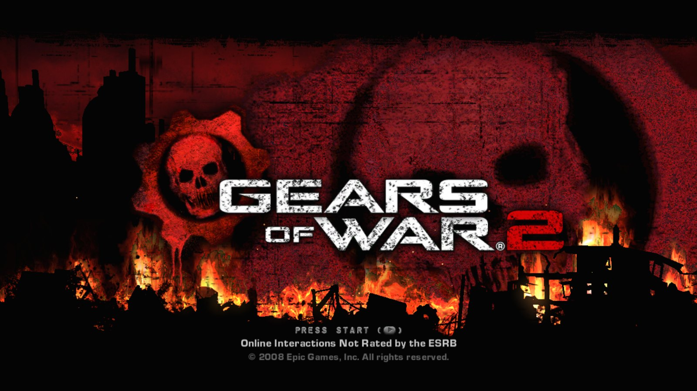
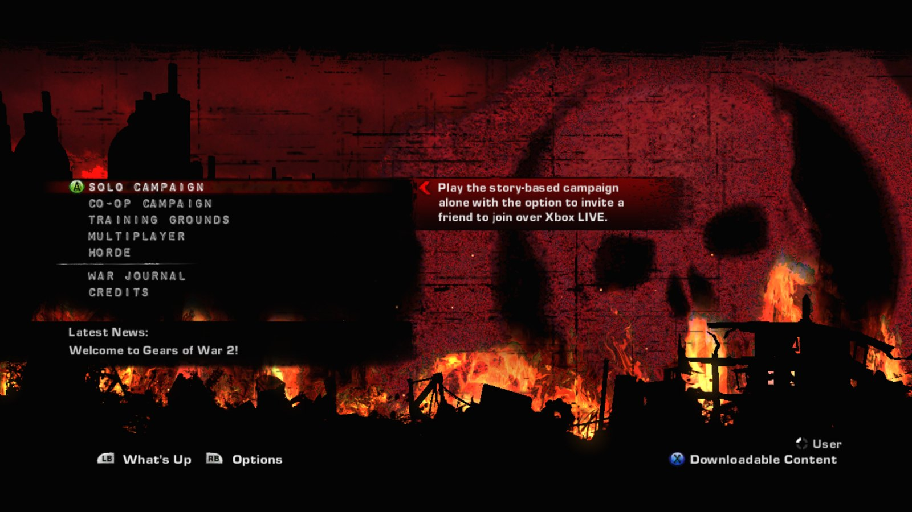
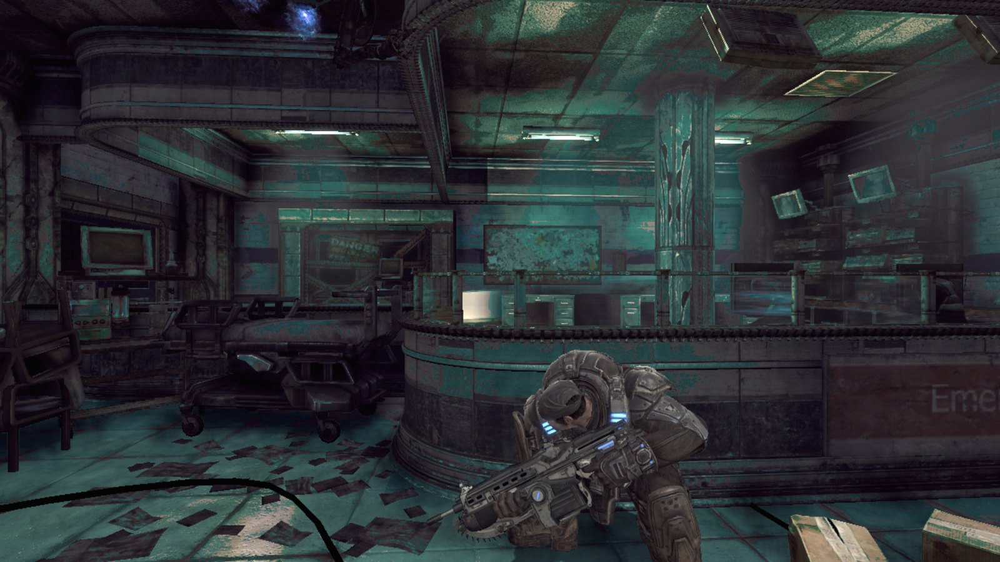
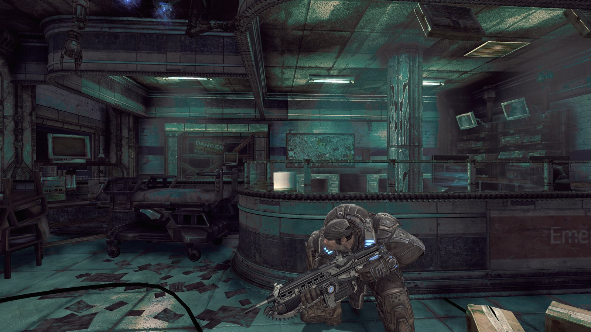
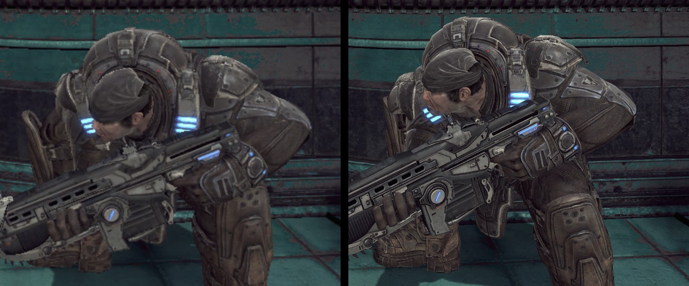
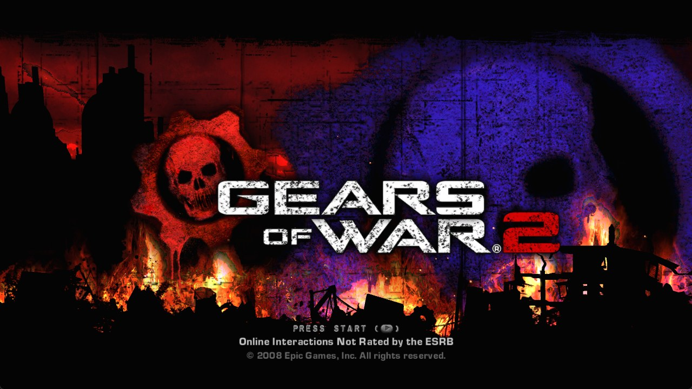

# Gears of War 2 — port nativo para PC (no oficial)

[](https://github.com/santiquiroz/gears-of-war-2-pc-port/releases/latest)
[](https://github.com/santiquiroz/gears-of-war-2-pc-port/releases)
[](LICENSE)
[](https://github.com/santiquiroz/gears-of-war-2-pc-port/stargazers)

**Sitio web:** [santiquiroz.github.io/gears-of-war-2-pc-port/es](https://santiquiroz.github.io/gears-of-war-2-pc-port/es/)

Gears of War 2 de Xbox 360, versión comercial, recompilado estáticamente desde el `default.xex` del propio jugador a código nativo x64 con el SDK de ReXGlue. No es emulación. Es necesario poseer el juego. Un port anterior hecho por fans ("Hollow") se construyó a partir de una versión de desarrollo filtrada de 2008; este ejecuta el juego comercial completo.

Read in English: [README.md](README.md)

## Capturas de pantalla






*Acto 1 con renderizado interno 4K (resolution_scale = 3).*



*Renderizado original 720p (izquierda) vs renderizado interno 4K (derecha).*

## Estado

- [x] Acto 1 jugable con teclado y mouse o con mando
- [x] Alta resolución nativa (`resolution_scale` 2 = 1440p, 3 = 4K interno)
- [x] Parches comunitarios del juego
- [x] Reescalado FSR 1 y nitidez CAS (`present_effect`)
- [x] Paquetes de texturas: volcar las texturas del juego y cargar tus propias versiones en mayor resolución
- [ ] Mirada con mouse que se sienta como un juego de PC (arreglo en progreso, ver Problemas conocidos)
- [ ] Reescalado temporal FSR 4 / DLSS (incluido, todavía no se activa en este juego)
- [ ] Campaña completa de principio a fin
- [ ] System Link (capa de sockets corregida y trazada; faltan las sesiones)

Ver el plan completo en [ROADMAP.md](ROADMAP.md).

## Descarga y juego

Descarga el zip de la versión desde la página de GitHub Releases.

Requisitos:

- Windows 10/11 x64.
- Una GPU con DirectX 12 (desarrollado en una AMD Radeon RX 7800 XT).
- Tu propia copia comercial de Gears of War 2 para Xbox 360 (ID de título `4D53082D`), volcada a una carpeta con `default.xex` y `GearGame`, por ejemplo extrayendo tu ISO con [xdvdfs](https://github.com/antangelo/xdvdfs):

  ```text
  xdvdfs unpack "Gears of War 2.iso" C:\Games\GoW2
  ```

Descomprime en cualquier lugar y ejecuta `gow2.exe`: el primer arranque pide la carpeta del juego y la recuerda en `gow2_game_path.txt`. Como alternativa, pasa la carpeta directamente:

```text
gow2.exe --game_data_root="C:\path\to\game"
```

La versión no incluye nada del juego. No piratees el juego.

## Controles

| Acción | Tecla |
|---|---|
| Moverse | W / A / S / D |
| Mirar | Mouse (o flechas del teclado) |
| Disparar | Botón izquierdo del mouse |
| Apuntar | Botón derecho del mouse |
| Cobertura / carrera roadie / voltereta | Espacio |
| Cuerpo a cuerpo / motosierra (mantener) | F o V |
| Usar / recoger / reanimar | E |
| Punto de interés | Q |
| Recargar | R |
| Pantalla táctica | G |
| Zoom | Botón central del mouse o Z |
| Armas | 1–4 |
| Pausa | Enter o Esc |
| Atrás | Tab |

Un mando funciona al mismo tiempo. Todas las asignaciones están en `gow2.toml`.

## Ajustes

`gow2.toml` se encuentra junto al exe. Se lee al arrancar; las opciones de línea de comandos (`--nombre=valor`) tienen prioridad sobre él. Claves principales:

- `fullscreen` — pantalla completa o ventana.
- `resolution_scale` — resolución interna de renderizado como múltiplo de 720p: 1 = 720p, 2 = 1440p, 3 = 4K.
- `present_effect` — escalado de la imagen final: `bilinear` con el runtime estándar; `fsr`, `cas` y rutas temporales experimentales con un runtime compilado desde el código fuente (ver abajo).
- `vsync` — sincronización vertical.
- `gow2_unlock_fps` — elimina el límite de 30 fps del juego.
- `gow2_black_shading_fix` — iluminación correcta de los personajes.
- `gow2_texture_streaming_fix` — reserva de texturas más grande, menos apariciones repentinas.
- `gow2_aniso16` — filtrado anisotrópico 16x.
- `gow2_ao_upscaling_fix` — oclusión ambiental sin artefactos al escalar.
- `gow2_dof_upscaling_fix` — profundidad de campo sin artefactos al escalar.
- `mnk_sensitivity` — sensibilidad del mouse.

Los parches comunitarios vienen de [xenia-canary/game-patches](https://github.com/xenia-canary/game-patches) (autores illusion y boma); los sitios y valores parcheados para este XEX se aplican al código generado, cada uno detrás de su ajuste `gow2_*`.

## Rendimiento

Medido en un Ryzen 9 7900X3D + Radeon RX 7800 XT, Acto 1, `resolution_scale = 2` (1440p interno): unos 90 cuadros presentados por segundo en promedio, 1% bajo en 55, GPU unos 6 ms por cuadro (PresentMon 2.6, captura de 30 s). Estas cifras son cuadros presentados.

## Mejoras modernas

- Resolución nativa mediante `resolution_scale` (ver Ajustes).
- FSR: el runtime de la versión viene compilado con AMD FidelityFX. `present_effect = "fsr"` renderiza con un `resolution_scale` menor y reescala con FSR 1 más nitidez; `"cas"` solo aplica nitidez. Medido con `resolution_scale = 1` y FSR 1 a 1440p: unos 85 fps en el Acto 1.
- Reescalado temporal: FSR 4.1 (Radeon RX 7000/9000, con las DLL firmadas del FidelityFX SDK 2.3 de AMD), FSR 3.1 en otras GPU y DLSS en NVIDIA (con tu propio `nvngx_dlss.dll`, ver THIRD_PARTY_NOTICES.md) vienen incluidos, portados de la recompilación de Gears of War: Judgment. Todavía no se activa en este juego: su detección de la escena espera la estructura de frame de Judgment y se está calibrando. Desactivado por defecto (`gow2_temporal`, `gow2_upscaler`).
- Paquetes de texturas: ver la siguiente sección. Probado con una textura reemplazada por una versión del doble de tamaño:

  

## Paquetes de texturas

Reemplaza las texturas del juego por versiones de mayor resolución (por ejemplo reescaladas 4x). El juego no trae texturas incluidas, así que cada jugador crea sus paquetes desde su propia copia: los paquetes nunca deben incluir archivos del juego, solo tus propios DDS retocados con sus nombres de hash.

1. Activa `texture_dump = true` en `gow2.toml` y juega. Los volcados quedan en `textures\4D53082D\dump` junto a `gow2.exe`, un archivo `.dds` por textura única, con el nombre `<hash>_<formato>_<ancho>x<alto>.dds`. Los videos y otras texturas que cambian en cada frame se omiten.
2. Convierte los volcados a PNG con `tools\texpack.py` (viene en la versión; necesita Python 3 y Pillow, `pip install pillow`): `python tools\texpack.py to-png textures\4D53082D\dump work` convierte la carpeta completa.
3. Reescala el PNG con cualquier herramienta (Upflow en GPUs AMD, chaiNNer, Upscayl).
4. Convierte de vuelta con la cadena de mipmaps completa: `python tools\texpack.py from-png work textures\4D53082D\replace`. Los nombres se mantienen; el juego reconoce cada archivo por el hash al inicio del nombre. Esto genera DDS sin comprimir; para archivos unas 4 veces más chicos, comprímelos con texconv de Microsoft: `texconv -f BC7_UNORM -m 0 archivo.dds`.
5. Activa `texture_replace = true` en `gow2.toml` y juega. Antes de reescalar todo, comprueba que el reemplazo funciona con un color sólido: `python tools/texpack.py tint <volcado.dds> <reemplazo.dds>` y busca la textura teñida en el juego.

Un reemplazo se aplica cuando tiene al menos tantos niveles de mipmap como la textura del juego (la cadena completa hasta 1x1, que `from-png` ya genera), mantiene la misma proporción de aspecto y es al menos tan grande como la original.

## System Link

El juego en red local (LAN) para Horda y Versus se está implementando en el runtime. Listo hasta ahora: `system_link_trace = true` registra cada llamada de red y de sesión del juego (líneas `[netlink]`), las llamadas no implementadas devuelven errores correctos y las opciones de socket llegan a Windows con el orden de bytes correcto (el búfer de recepción de 128 KiB del juego quedaba en 512 bytes; reportado al SDK como rexglue-sdk#512). Siguiente paso: direcciones XNet reales y el servicio de sesiones, para que dos PC (o dos instancias en un mismo PC) se encuentren. Ver [ROADMAP.md](ROADMAP.md).

## Problemas conocidos

- **La mirada con mouse se siente rara.** El mouse se traduce a movimiento del stick derecho, y el juego ignora cualquier inclinación del stick menor al 30 % (su binding `DeadZone=0.3`): los movimientos lentos del mouse se pierden y los rápidos saltan. Está en progreso un arreglo que quita esa zona muerta para el mouse y la mantiene para los mandos.
- **Los íconos de botones muestran los del control de Xbox** aunque juegues con teclado. Las etiquetas de teclado están en progreso.
- **Se reportó iluminación verdosa** en la piel, las luces y las llamas del menú; todavía no se reproduce en el PC de desarrollo. Se agradecen capturas en un issue.
- Por ahora solo se jugó el Acto 1.

## Compilar desde el código fuente

Ver [BUILDING.md](BUILDING.md). Los scripts principales son `scripts/build.ps1`, `scripts/build-sdk.ps1` (opcional: añade FidelityFX/FSR, reescaladores temporales y trazado de system link) y `scripts/package.ps1`.

## Cómo encontrar las funciones que codegen no detecta

`tools/harvest_hints.py` analiza la imagen descifrada (exportada desde Ghidra con `tools/ghidra/ExportImage.java`) contra una generación de código base sin pistas (`scripts/codegen-baseline.sh`) y emite `hints/harvested.toml`: thunks de ajuste, entradas `.pdata`, punteros de código guardados en `.rdata`/`.data` y direcciones construidas en el código con `lis`+`addi`/`ori`. Las pistas que dividirían una función existente se detectan desde el registro de codegen con `tools/hint_fixpoint.py` y se excluyen mediante `hints/denylist.txt`. Lo que siga faltando se encuentra en tiempo de ejecución con `scripts/run-harvest-loop.sh` (arrancar, leer el FATAL de "unregistered function", añadirlo a `hints/runtime.toml`, recompilar).

## Créditos

- [ReXGlue SDK](https://github.com/rexglue/rexglue-sdk) (BSD-3-Clause, derivado de Xenia): runtime y generador de código.
- [OverkillLabs3/gears-judgement-recomp](https://github.com/OverkillLabs3/gears-judgement-recomp) (Gears of War: Judgment en ReXGlue, BSD-3-Clause): este repositorio copia `tools/patch_switch_traps.py` y `tools/check_objects_fresh.py` de él y adapta `scripts/build.ps1` de su `scripts/build.ps1`. Ver [THIRD_PARTY_NOTICES.md](THIRD_PARTY_NOTICES.md).
- [XenonRecomp](https://github.com/hedge-dev/xenonrecomp) (hedge-dev).
- [Xenia](https://github.com/xenia-project/xenia).
- AMD FidelityFX SDK (MIT).
- NVIDIA DLSS SDK.
- [PresentMon](https://github.com/GameTechDev/PresentMon) (usado para las mediciones).

## Legal

Proyecto no oficial. Sin afiliación ni respaldo de Microsoft, Xbox Game Studios, The Coalition o Epic Games. Todas las marcas pertenecen a sus dueños. El código propio de este repositorio tiene licencia BSD-3-Clause; ver [LICENSE](LICENSE).
